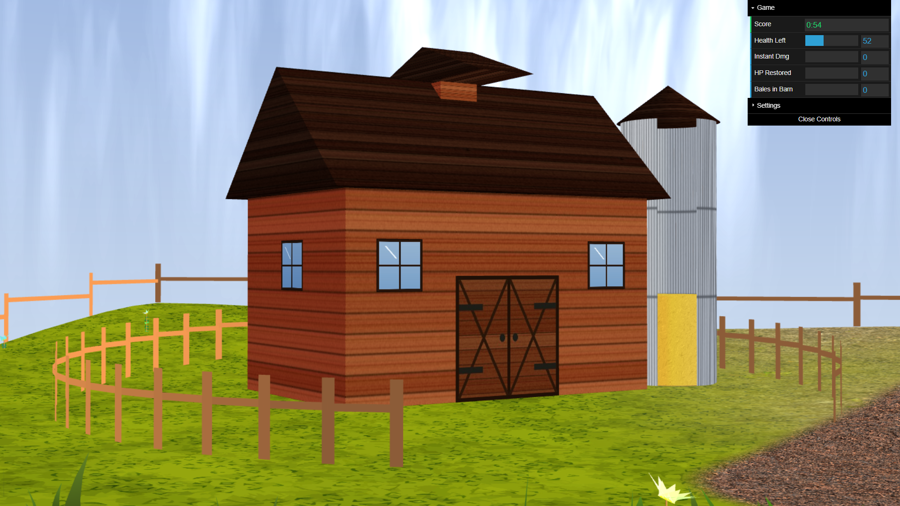

# Prairie Wagon Survival — CGRA Final Project

**Faculdade de Engenharia da Universidade do Porto**
**L.EIC — Computação Gráfica / Computer Graphics — 2025/2026**
**Class T03 · Group G01**

---

## Group Members

| Name             | Number    | E-Mail             |
| ---------------- | --------- | ------------------ |
| Gustavo Luís Almeida Geraço Lourenço         | 202306578 | up202306578@up.pt                |
| Pedro Alexandre Henriques Ferreira         | 202304412 | up202304412@up.pt                |
|Dinis Afonso Nunes Pinto|202306480|up202306480@up.pt|

---

## Scene Description

A WebGL survival game built on WebCGF. You drive a covered prairie wagon across a hilly terrain, collect hay bales scattered across the field, and bring them back to the barn to restore health. Rocks and trees deal damage on contact. Health runs down on its own. When it hits zero, the run ends — the score is how long you lasted.

The world is a spring prairie: procedurally displaced terrain, a noise-blended grass/dirt surface, an MST-generated wagon path, a scrolling cloud layer over a skybox, scattered rocks, L-System trees and flowers, and a textured barn with a circular fence. A horse (OBJ) pulls the wagon and pitches with the terrain slope. A silo next to the barn shows health as a fill level.

---

## How to Run

You need a browser with WebGL support (Chrome or Firefox). No build step required.

1. Serve the project folder over HTTP — WebGL won't load over `file://`:
   ```bash
   python3 -m http.server 8000
   ```
2. Open `http://localhost:8000`.
3. Press any key or click to start.

---

## Keyboard Controls

### Game Controls

| Key | Action |
|-----|--------|
| Any key / Click | Start from the start screen |
| W | Accelerate forward |
| S | Reduce speed (no reversing) |
| A | Steer left |
| D | Steer right |
| P | Pick up a nearby hay bale (max 2 at once) |
| L | Drop bale(s) inside the barn's circular fence |
| R | Restart (from the game-over screen) |

### Camera Controls

| Key | Action |
|-----|--------|
| Up Arrow | Raise camera |
| Down Arrow | Lower camera |
| Left Arrow | Zoom out |
| Right Arrow | Zoom in |

### Debug Controls

| Key | Action |
|-----|--------|
| 1 – 5 | Pick up a specific bale by field index |
| 0 | Drop bale from anywhere |
| U | Trigger a 180° U-turn |

---

## Implemented Features

### Week 8 — Sky, Sun & Clouds (`environment` tag)

The skybox is an inverted half-sphere with a custom sky shader. The sun runs a camera-dot-product glow shader (`sun.vert` / `sun.frag`) and orbits the scene over time.

For the advanced cloud option: a second sphere sits just inside the skybox and runs a 6-octave fBm Perlin noise shader (`cloud.frag`) that scrolls with time. Density, speed, and scale are adjustable from the GUI panel.

### Week 9 — Terrain, Ground & Scatter Elements (`terrain` tag)

For the advanced terrain option: terrain height is computed entirely in the vertex shader (`terrain.vert`) using 3-octave fBm with quintic-interpolated Perlin noise. No heightmap image is used. The same formula runs on the CPU side so object placement matches the visible surface.

Grass and dirt textures blend in the fragment shader via a noise mask (`terrain.frag`). The wagon path is computed with Prim's MST algorithm over seeded random points in UV space, uploaded to the terrain shader as a `vec4` array uniform, and drawn on the GPU.

Rocks are placed procedurally from a seed (`MyRock.js`). Vertex perturbation and two-texture blending (white and black rock textures) run in `rock.vert` / `rock.frag` — that's the advanced scatter option.

Trees are L-System-based (`MyLSystem`, `MyLSTree`) with stochastic rewriting rules and per-instance scale.

All scatter elements avoid the path and barn exclusion zones. That covers the advanced flora option.

### Week 10 — Flowers & Grass (`flora` tag)

Flowers use the same L-System approach (`MyLSFlower`, `TopFlower`) with randomised colour, scale, and placement. Flowers also avoid the path and barn exclusion zones. That covers the advanced flora option.

Grass spawns in noise-seeded clusters. Each blade gets a health value that blends its colour from green to brown. The wind shader (`wind.vert`) runs three sinusoidal harmonics at irrational frequency ratios, plus a slow gust envelope and Z sway, so the field breathes rather than swings at a fixed rate. Per-blade world-position phase offsets produce a travelling wave across the field — that's the advanced grass shader option. Grass also avoids the path and barn exclusion zones. That covers the advanced flora option.

### Week 11 — Wagon, Interaction & Animation (`interaction` tag)

The wagon is a hierarchical model in `MyWagon.js`: wooden bed, half-open cloth canopy (to show hay bales), front tongue, and four spoked wheels. A horse OBJ (`horse3.obj`, loaded via `CGFobjModel`) sits ahead of the wagon and gets pitch-corrected each frame against the terrain slope.

Wheels rotate proportionally to speed. The front axle and tongue pivot around the wagon's Y-axis when steering. For the advanced movement option, friction splits into on-path and off-path coefficients, and steering is multiplied by speed so the wagon can't spin in place. A 180° U-turn animation fires on U or on fence/border collision.

### Week 12 — Collectable System & UI (`gameplay` tag)

Five hay bales spawn on MST path nodes at start. When one or fewer remain and the wagon is empty, five new ones appear. The wagon holds up to 2 bales at once; dropping inside the fence restores health (1 bale → +18 s, 2 bales → +32 s).

Each bale has a bobbing arrow above it. `arrow.vert` applies a pre-computed Y offset each frame; `arrow.frag` colours the tip orange and the base yellow. The arrow disappears when the bale is picked up.

Collision detection runs continuously against rocks, trees, the barn, and the world border. Rocks and trees deal a random damage between 5 and 15HP; the fence and border trigger the U-turn. The silo fill level stays in sync with health. The fence highlight changes state when the wagon enters the drop zone.

Game states: start screen → playing → game-over overlay. The DAT.gui HUD shows Score (MM:SS), Health Left, Instantaneous Damage, Instantaneous Health Points Restored, and amount of bales delivered to the barn.

---

## Screenshots

| Tag | Screenshot 1 | Screenshot 2 |
|-----|-------------|-------------|
| `environment` |  |  |
| `terrain` |  |  |
| `flora` |  |  |
| `interaction` |  |  |
| `gameplay` |  |  |

Final:





---

## Advanced Features Summary

| Category | Advanced Option Chosen |
|----------|----------------------|
| Sky / Clouds | Procedural animated cloud layer (fBm Perlin noise shader) |
| Terrain elevation | Fully procedural GLSL terrain (no heightmap image) |
| Scatter Elements | Procedural elements placement and vertex perturbation |
| Flora | L-System procedural generation for trees and flowers |
| Grass | Wind shader with multi-harmonic sway and gust envelope |
| Wagon | Physics-based kinematics (acceleration + friction), high detail (hierarchical model down to the plank element), and rigorous wagon and horse movement |
| Barn | Detailed barn with visual feedback on fence intersection |
| Shaders | Procedural noise for clouds, terrain height, grass wind, hay arrows, rock visual noise, map skirt, sky, and sun |

---

## Known Issues / Limitations

- The path-edge uniform is capped at `MAX_PATH_EDGES`; paths with more segments silently drop the excess on the GPU.
- The CPU terrain formula mirrors the GLSL fBm, but floating-point differences between JS and GLSL can slightly misalign object placement and the visible surface.
- The horse has no locomotion animation (static OBJ, as per spec).
- The last path seed saves to `localStorage`; clearing site data resets it to the default random path generation on load.

---

## AI Use Declaration

We used Claude (Anthropic) as a debugging aid during development. The main areas were: texture unit binding order in WebGL, sampler uniform timing relative to `setActiveShader`, and getting the noise parameters right for terrain height and cloud density. We also used it for code review on `MyScene.js` and to help draft this README.

We also used the above tool as a validation tool of our work at some intermediate deliveries and at the final delivery.

We reviewed and tested everything before it went into the codebase. The architecture, shader design, and implementation decisions were ours.