# Prairie Wagon Survival

A WebGL survival game built on WebCGF: drive a covered prairie wagon across procedurally generated terrain, collect hay bales, and avoid rocks and trees. Built for the Computer Graphics course (L.EIC, FEUP, 2025/26) in a group of three.

[Demo video](https://youtu.be/Blmsztga7Yk)

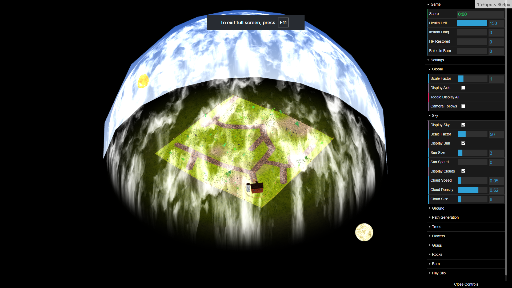

## Team

- Gustavo Lourenço ([@GustLou](https://github.com/GustLou))
- Pedro Ferreira
- Dinis Pinto

## My Contributions

- **Path generation:** the wagon path, built with Prim's MST algorithm over seeded random points in UV space, uploaded to the terrain shader as a `vec4` array uniform and drawn on the GPU.
- **Ground:** the procedural terrain, with height computed in the vertex shader (3-octave fBm, quintic-interpolated Perlin noise) and grass/dirt blended in the fragment shader through a noise mask.
- **Grass and wind:** noise-seeded grass clusters with per-blade health-based colour (green to brown), and a wind shader with three sinusoidal harmonics at irrational frequency ratios, a slow gust envelope, and per-blade phase offsets that produce a travelling wave.

Other parts of the project (sky and clouds, L-System flora, wagon, gameplay) were built by my teammates.

## Game Description

You drive a covered prairie wagon across hilly terrain, collect hay bales scattered across the field, and bring them back to the barn to restore health. Rocks and trees deal damage on contact, and health runs down on its own. When it hits zero, the run ends, and the score is how long you lasted.

The world is a spring prairie: procedurally displaced terrain, a noise-blended grass/dirt surface, an MST-generated wagon path, a scrolling cloud layer over a skybox, scattered rocks, L-System trees and flowers, and a textured barn with a circular fence. A horse (OBJ) pulls the wagon and pitches with the terrain slope. A silo next to the barn shows health as a fill level.

## How to Run

You need a browser with WebGL support (Chrome or Firefox). No build step is required.

1. Serve the project folder over HTTP, since WebGL won't load over `file://`:
```bash
   python3 -m http.server 8000
```
2. Open `http://localhost:8000`.
3. Press any key or click to start.

## Controls

### Game

| Key | Action |
|-----|--------|
| Any key / Click | Start from the start screen |
| W | Accelerate forward |
| S | Reduce speed (no reversing) |
| A | Steer left |
| D | Steer right |
| P | Pick up a nearby hay bale (max 2 at once) |
| L | Drop bale(s) inside the barn's circular fence |
| R | Restart (from the game-over screen) |

### Camera

| Key | Action |
|-----|--------|
| Up Arrow | Raise camera |
| Down Arrow | Lower camera |
| Left Arrow | Zoom out |
| Right Arrow | Zoom in |

### Debug

| Key | Action |
|-----|--------|
| 1 – 5 | Pick up a specific bale by field index |
| 0 | Drop bale from anywhere |
| U | Trigger a 180° U-turn |

## Features

### Sky, Sun and Clouds

The skybox is an inverted half-sphere with a custom sky shader. The sun runs a camera-dot-product glow shader (`sun.vert` / `sun.frag`) and orbits the scene over time.

A second sphere sits just inside the skybox and runs a 6-octave fBm Perlin noise shader (`cloud.frag`) that scrolls with time. Density, speed, and scale are adjustable from the GUI panel.

### Terrain and Scatter Elements

Terrain height is computed entirely in the vertex shader (`terrain.vert`) using 3-octave fBm with quintic-interpolated Perlin noise. No heightmap image is used. The same formula runs on the CPU side so object placement matches the visible surface.

Grass and dirt textures blend in the fragment shader via a noise mask (`terrain.frag`). The wagon path is computed with Prim's MST algorithm over seeded random points in UV space, uploaded to the terrain shader as a `vec4` array uniform, and drawn on the GPU.

Rocks are placed procedurally from a seed (`MyRock.js`). Vertex perturbation and two-texture blending (white and black rock textures) run in `rock.vert` / `rock.frag`.

Trees are L-System-based (`MyLSystem`, `MyLSTree`) with stochastic rewriting rules and per-instance scale. All scatter elements avoid the path and barn exclusion zones.

### Flowers and Grass

Flowers use the same L-System approach (`MyLSFlower`, `TopFlower`) with randomised colour, scale, and placement, and also avoid the exclusion zones.

Grass spawns in noise-seeded clusters. Each blade gets a health value that blends its colour from green to brown. The wind shader (`wind.vert`) runs three sinusoidal harmonics at irrational frequency ratios, plus a slow gust envelope and Z sway, so the field breathes rather than swings at a fixed rate. Per-blade world-position phase offsets produce a travelling wave across the field.

### Wagon, Interaction and Animation

The wagon is a hierarchical model in `MyWagon.js`: wooden bed, half-open cloth canopy (to show hay bales), front tongue, and four spoked wheels. A horse OBJ (`horse3.obj`, loaded via `CGFobjModel`) sits ahead of the wagon and is pitch-corrected each frame against the terrain slope.

Wheels rotate proportionally to speed. The front axle and tongue pivot around the wagon's Y-axis when steering. Friction splits into on-path and off-path coefficients, and steering is multiplied by speed so the wagon can't spin in place. A 180° U-turn animation fires on U or on fence/border collision.

### Gameplay and UI

Five hay bales spawn on MST path nodes at start. When one or fewer remain and the wagon is empty, five new ones appear. The wagon holds up to 2 bales at once, and dropping them inside the fence restores health (1 bale: +18 s, 2 bales: +32 s).

Each bale has a bobbing arrow above it. `arrow.vert` applies a pre-computed Y offset each frame, and `arrow.frag` colours the tip orange and the base yellow. The arrow disappears when the bale is picked up.

Collision detection runs continuously against rocks, trees, the barn, and the world border. Rocks and trees deal random damage between 5 and 15 HP, and the fence and border trigger the U-turn. The silo fill level stays in sync with health, and the fence highlight changes state when the wagon enters the drop zone.

Game states are start screen, playing, and game-over overlay. The DAT.gui HUD shows score (MM:SS), health left, instantaneous damage, instantaneous health restored, and bales delivered to the barn.

### Extra Features

- The sun and moon spin around themselves and cycle around the map, changing the lighting position and intensity to create a day/night cycle.
- The wagon and horse pivot vertically according to the terrain height, using three joints: the back of the wagon, the front of the wagon, and the horse's front hooves.
- On collision, the wagon plays a short animation where it turns around and speeds up slightly, so it never gets stuck against an object.
- A hay silo next to the barn visually represents the proportion of health left.

## Screenshots

| Feature | Screenshot 1 | Screenshot 2 |
|---------|-------------|-------------|
| Environment | 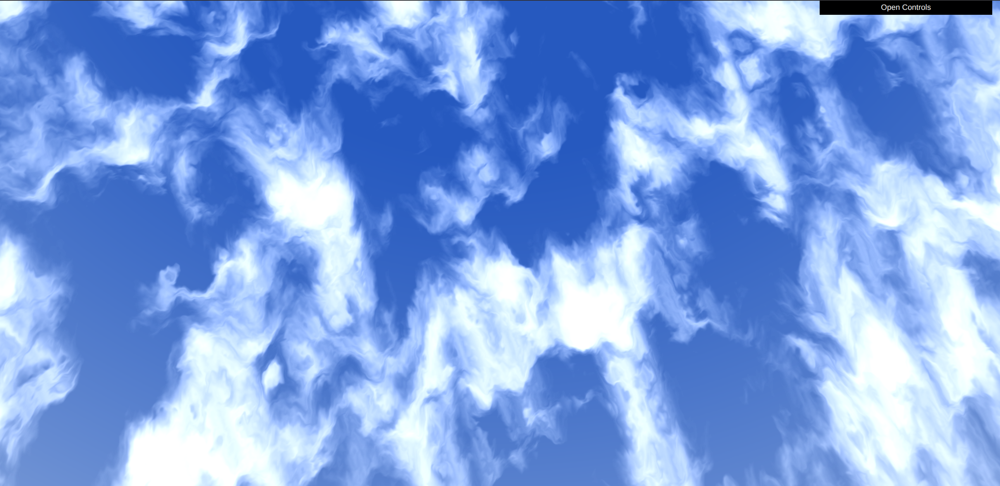 | 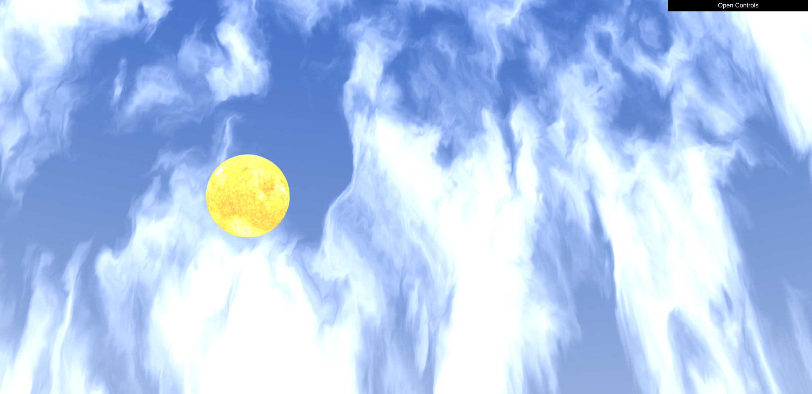 |
| Terrain | 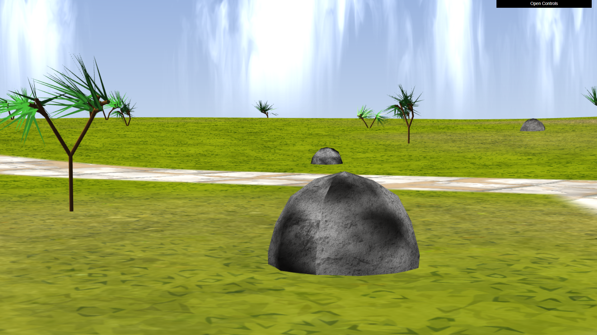 | 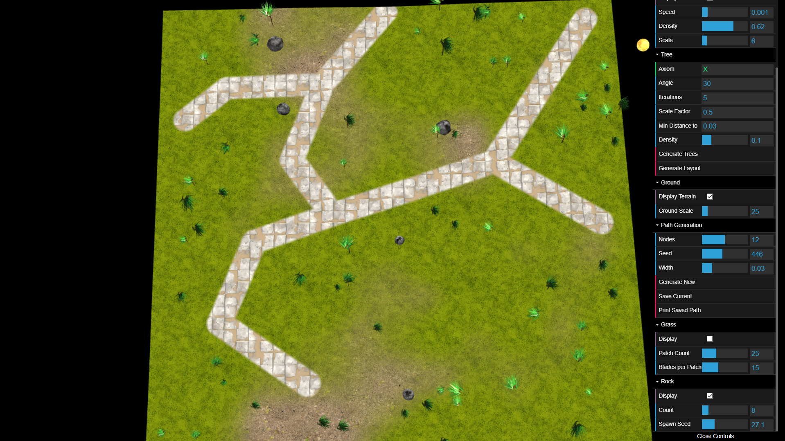 |
| Flora | 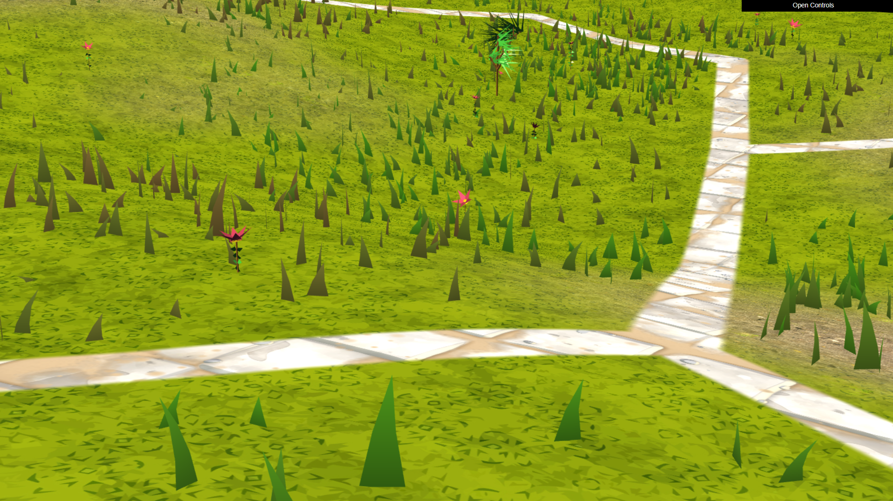 | 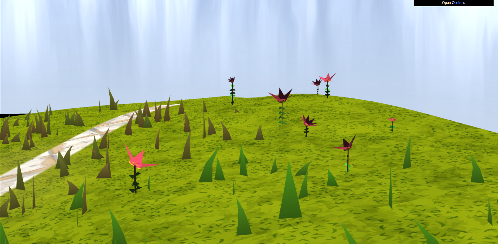 |
| Interaction | 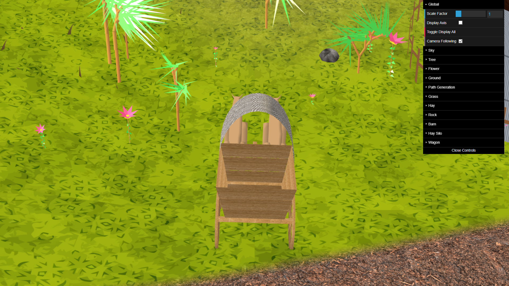 |  |
| Gameplay | 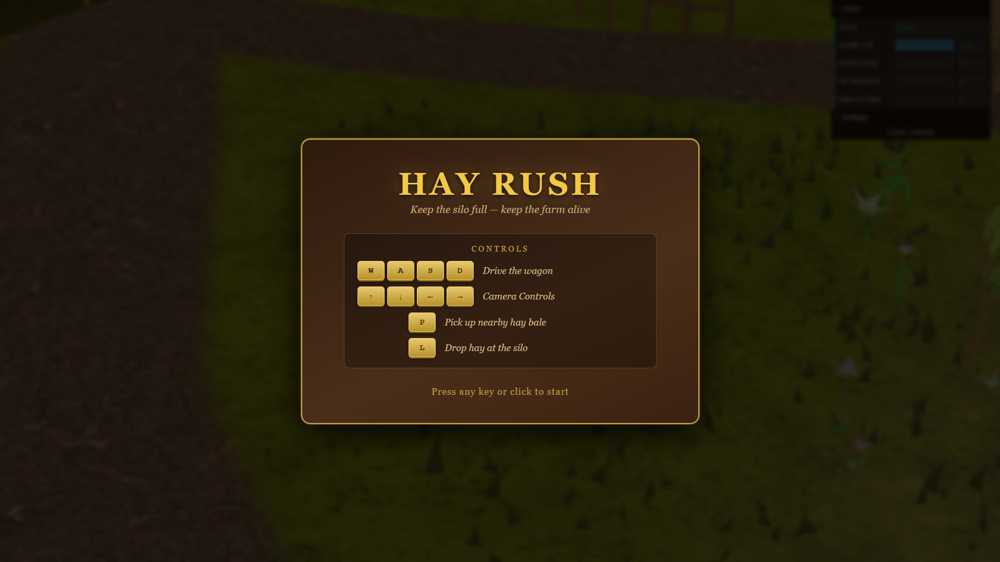 | 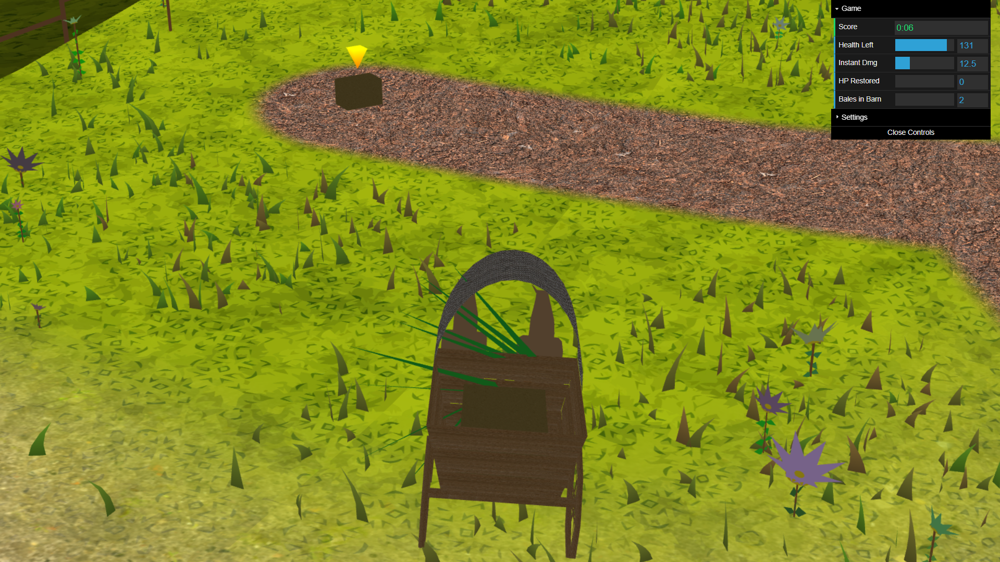 |

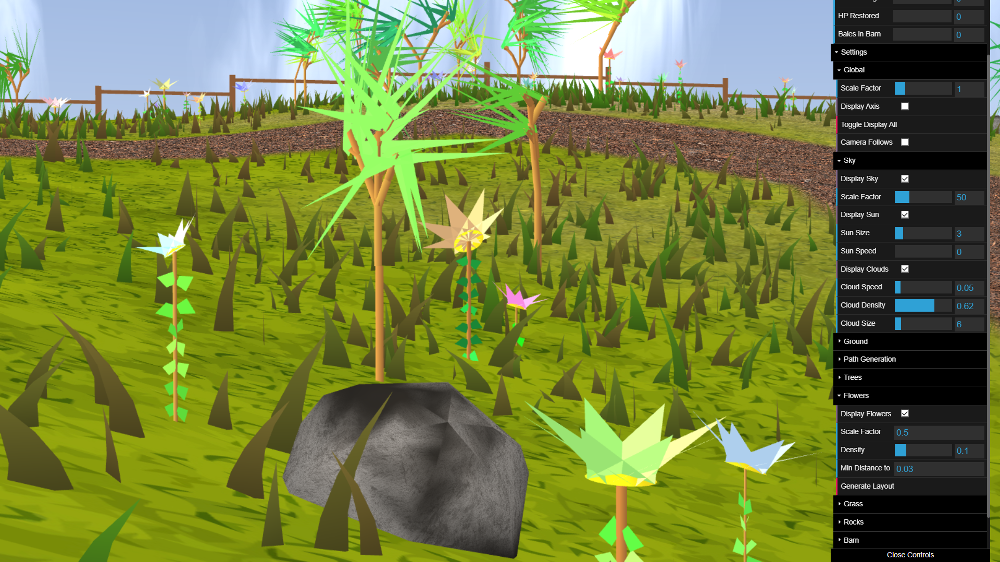
Flowers, rocks and floor detail

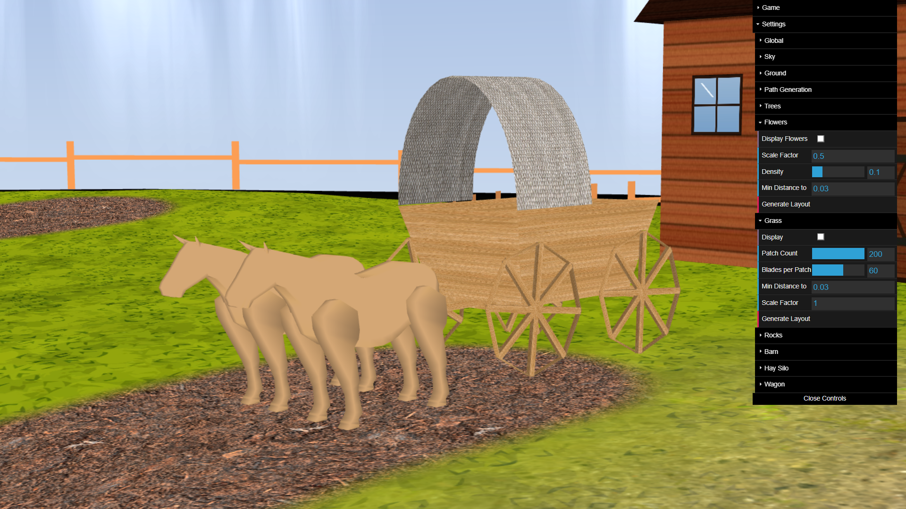
Wagon close-up showing model detail and textures


Shader animations: clouds, sky, arrow, grass and wagon

![Bar